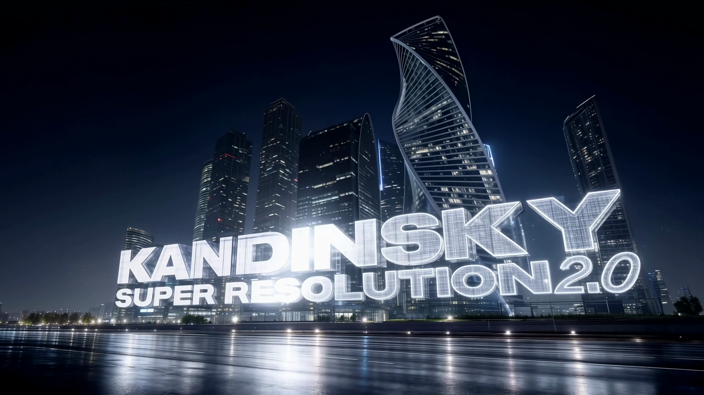

<div align="center">
  <a href="https://huggingface.co/kandinskylab/Kandinsky-ImageSR-2.0/blob/main/assets/promo.mp4">
    
  </a>
  <br>
  <a href="https://huggingface.co/kandinskylab/Kandinsky-ImageSR-2.0/blob/main/assets/promo.mp4"><b>▶ Watch the video</b></a>
</div>

<br>

<div align="center">
<picture>
  <source media="(prefers-color-scheme: dark)" srcset="assets/Kandinsky_SR_2.0_LOGO_V2_small_second_line_white.png">
  
</picture>
</div>

<br>

<div align="center">

<a href="https://kandinskylab.ai/"></a>

<a href="https://huggingface.co/kandinskylab/Kandinsky-ImageSR-2.0"></a>

</div>

# Kandinsky ImageSR 2.0

Diffusers-native inference pipeline for the Kandinsky Image Super-Resolution 2.0 model.
A single set of transformer weights serves both `x2` and `x4`. The release uses pre-baked
zero-text conditioning: the text tower and all 50 cross-attention layers are replaced by
small per-timestep Safetensors tables.

## Install

```bash
pip install git+https://github.com/kandinskylab/kandinsky-image-sr.git
```

The pipeline uses the Kandinsky 5 transformer included in Diffusers 0.41 or newer.

In a checkout, [`just`](https://github.com/casey/just) installs the package with the dev
tools through [`uv`](https://docs.astral.sh/uv/). uv detects the NVIDIA driver and takes torch
from the matching PyTorch wheel index:

```bash
just setup        # create .venv
just setup-conda  # or install into the active conda environment
# force a specific build: just torch_backend=cu130 setup
```

### FlashAttention-2 (optional)

Attention runs on PyTorch SDPA by default. To use FlashAttention-2 instead, install the
`flash` extra (Linux with CUDA; flash-attn is built from source and needs `nvcc`):

```bash
pip install "kandinsky-image-sr[flash] @ git+https://github.com/kandinskylab/kandinsky-image-sr.git"
# in a checkout: just setup flash  (or just setup-conda flash)
```

and switch the transformer to it after loading the pipeline:

```python
pipe.transformer.set_attention_backend("flash")
```

## Inference

```python
import torch
from kandinsky_image_sr import KandinskyImageSRPipeline

pipe = KandinskyImageSRPipeline.from_pretrained(
    "kandinskylab/Kandinsky-ImageSR-2.0",
    dtype=torch.bfloat16,
).to("cuda")
# Optional: FlashAttention-2 instead of PyTorch SDPA (needs the `flash` extra, see Install).
# pipe.transformer.set_attention_backend("flash")

result = pipe(
    "input.png",
    upscale_factor=4,
    # Optional. Defaults: x2=0.15, x4=0.244.
    one_step_t=0.244,
)
result.images[0].save("output.png")
```

The same run is available from the command line and as a notebook. Both use FlashAttention-2
when the `flash` extra is installed and fall back to PyTorch SDPA otherwise:

```bash
python scripts/run_inference.py --input input.png --output output.png --upscale-factor 4
# --attention flash|native forces a backend; see --help for creativity, seed and device
```

See [`notebooks/inference_example.ipynb`](notebooks/inference_example.ipynb) for the notebook.

For calibrated UI controls, `creativity` accepts levels `0..8` at x2 and x4; level 4
corresponds to the default `t`. The release accepts the defaults and the 18 creativity
values listed in its config; other raw `one_step_t` values are not supported.

| Factor | Default `t` | Calibrated creativity range |
|---:|---:|---:|
| x2 | 0.15 | 0.07–0.30 |
| x4 | 0.244 | 0.17–0.38 |

The model processes 1024-pixel output tiles and blends overlaps with boundary-aware Hanning
windows. Small inputs are replicate-padded and cropped back to the exact requested size.

### Inference time

Measured on an NVIDIA H100 using square images.

| Input resolution | Upscale | Output resolution | Tile grid | Time per image |
|---|:---:|---|:---:|---:|
| 1K (1024 × 1024) | ×2 | 2K (2048 × 2048) | 3 × 3 | 1.79 s |
| 1K (1024 × 1024) | ×4 | 4K (4096 × 4096) | 5 × 5 | 4.9 s |
| 2K (2048 × 2048) | ×2 | 4K (4096 × 4096) | 5 × 5 | 4.9 s |
| 2K (2048 × 2048) | ×4 | 8K (8192 × 8192) | 11 × 11 | 23.4 s |
| 4K (4096 × 4096) | ×2 | 8K (8192 × 8192) | 11 × 11 | 23.4 s |

## License

The code and model release use the MIT License, consistently with Kandinsky 5. The bundled
VAE is sourced from the Apache-2.0-licensed `black-forest-labs/FLUX.1-schnell` release.
